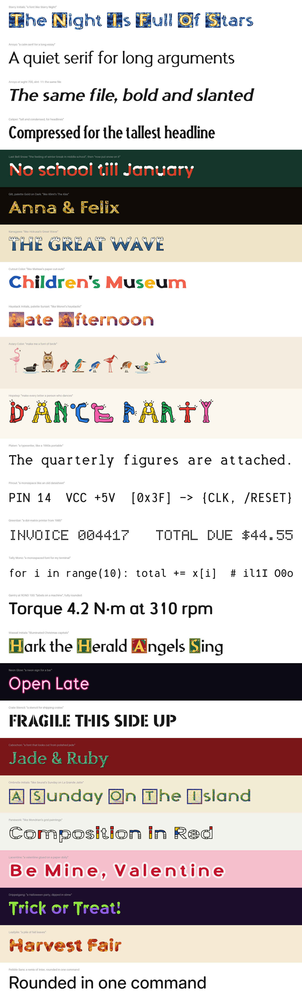

# WhateverFont

Describe a typeface in plain words. An AI agent draws it with WhateverFont, checks its own proofs, and gives
you font files (TTF, WOFF2 and a variable font).



Every font in that picture was made by an agent with this engine, and the gray line above each row is the
request that started it. Every row but the last is drawn by the engine's own recipes. The last row restyles an
existing open font.

WhateverFont is a prototype. Read [what it can't do yet](#what-it-cant-do-yet) before you rely on it.

## Why

Most good typefaces must be bought, and the free ones appear on many sites. An agent that builds a page or a
slide deck for you usually sets it in one of a few common free fonts. A typeface is a finite thing, though: a
few hundred shapes that follow a small set of repeated decisions. An agent can make those decisions, as long
as it does not have to guess raw outline coordinates.

With WhateverFont, the agent writes a few numbers ("stems 82 units thick, thin strokes at 60% of thick ones,
ends flared by 34%") and, when a letter needs it, a short recipe that places the skeleton of that letter. The
engine does the parts that need precision: it gives the skeleton thickness, spaces and kerns the letters, and
compiles the files.

## What it has

- An engine of skeleton strokes and a pen model. One set of letter recipes draws a hairline sans, a bold
  flare serif, a rounded display face or a broad-pen book hand, depending on 34 parameters.
- Axes for weight, width, slant or any other numeric parameter. Each named style is drawn exactly, and the
  whole design space also ships as one variable font.
- Proofs: `whateverfont look` renders the built font file, shaped with HarfBuzz, as a PNG image that the agent
  opens. `whateverfont probe` reports measurements and problems as JSON.
- A review board: one HTML page for each project. You type your own text, compare directions, drag the axes,
  pick one, and write notes. The agent reads your feedback and revises.
- Effects that add a stencil, an engraved line, a block shadow, speed stripes or a hand-cut edge in one call.
  An effect is a short function, so an agent can write a new one for a brief that needs it.
- Color fonts: neon glow, brush marks that follow the pen, mosaic, dots, bands, and decorated capitals, with
  palettes you can switch. They use COLR version 0, which every major browser draws.
- Monospaced fonts: set one number and every glyph fits one cell, with the signs of code drawn for code and
  the box-drawing characters included. Slab serifs make a typewriter.
- 800 code points in the full set. It has GF Latin Core, the whole Vietnamese alphabet with its horn, hook
  above, dot below and stacked marks, Pinyin, and letters for Azerbaijani, Yoruba, Igbo and Hausa. It has
  modern Greek with the tonos and the dialytika, and Cyrillic for Russian, Ukrainian, Belarusian, Bulgarian,
  Serbian, Macedonian and Kazakh, drawn with the same pen as the Latin letters. It also has 34 currency signs,
  the Mac Roman math signs, arrows, check marks and shapes, superscripts, subscripts and 15 fractions.
- OpenType features: `frac` (1/2 becomes a fraction), `sups`, `subs`, `numr`, `dnom`, `ordn`, `zero`
  (a slashed zero), `case` (dashes and brackets for capitals) and `pnum` (proportional figures). The default
  figures are tabular, and a family can turn that around.
- Picture fonts: a recipe can draw any shape, so a font can set a bird for each letter.
- Remix: one command rounds the corners of an existing font, or emboldens, slants or narrows it.
- Reproducible builds: the same design gives the same bytes, and `look` and `board` build again only when the
  project changed. The `arroyo` example (three families, each with six styles and three axes) builds in
  10 to 30 seconds on a 16-core laptop, depending on what else the laptop runs.

## Quick start

With an agent (Claude Code, Codex, Cursor or any agent that can run commands):

```sh
uv tool install whateverfont        # or: pipx install whateverfont
whateverfont skill install          # adds the skill to Claude Code
```

With Node and uv (or pipx), `npx whateverfont setup` does both: it installs the command and adds the skill to
Claude Code. In Claude Code you can also add the skill as a plugin:
`/plugin marketplace add brianlzhou/whateverfont`, then `/plugin install whateverfont@whateverfont`. The
plugin holds the skill, and the skill tells the agent how to install the command.

Then ask, in a new session:

> Use whateverfont. Make me a font that gives me the feeling of winter break and Christmas holidays in middle school.

The agent writes the brief down, draws three directions, looks at its own proofs, and gives you a review
board in the browser. Say what to change ("chunkier", "the tails on g and y hang too low", "now put snow on
it") until it is right. The font files are in `fonts/NAME/fonts/`. For an agent without skills, say "run
`whateverfont skill show` and follow it".

By hand:

```sh
whateverfont new fonts/quill --preset flare --brief "A calm serif for a long essay. No default web serifs."
whateverfont build fonts/quill        # TTF, WOFF2, a variable font, and board.html
whateverfont look fonts/quill         # prints the path of a proof sheet (PNG)
open fonts/quill/board.html       # compare, adjust, pick
```

A project is a folder with two files. `font.py` is the design:

```python
from whateverfont import Axis, Family
from whateverfont.presets import preset

FAMILY = Family(
    name="Quill",
    base=preset("flare", contrast=0.55, xh=500),
    axes=[
        Axis("wght", "Weight", 300, 400, 800, {300: {"weight": 50}, 800: {"weight": 150}}),
        Axis("slnt", "Slant", -11, 0, 0, {-11: {"slant": 11}}),
    ],
    styles={"Regular": {}, "Italic": {"slnt": -11}, "Bold": {"wght": 700}},
)
```

`BRIEF.md` holds the brief in your words, and the agent's design decisions and your feedback over time.

## Use it with an agent

`whateverfont skill install` copies the skill to `~/.claude/skills/whateverfont`. Add `--project` for the project
you are in, or `--dest DIR` for the skills folder of another agent. `whateverfont skill show` prints it, so any
coding agent can read the same instructions. The skill is one page:
[`skills/whateverfont/SKILL.md`](skills/whateverfont/SKILL.md).

The skill tells the agent to write the brief down, propose three directions, build them, look at the proofs
and fix what it sees, and give you the review board. `whateverfont docs` and `whateverfont examples` give the agent
the reference pages and the sources of every example, so it needs no checkout of this repository.

Eight of the examples were made this way, by agents that had only the skill and a request of a few sentences,
such as "Make me a font like Klimt's The Kiss". The table of examples marks them. The agents also
wrote down what tripped them up, and several fixes in the engine came from those notes.

## Share a font

The [library](library) holds fonts that people made with WhateverFont and shared under the SIL Open Font
License. Each one is on
the [library page](https://fonts.brianzhou.org/library/) with the GitHub name of the person who added it.

```sh
gh repo fork brianlzhou/whateverfont --clone && cd whateverfont
whateverfont library add PATH/TO/YOUR/FONT --github YOUR_USERNAME
```

The second command copies your design into `library/`, checks that it builds, and prints the commands that
open the pull request. A pull request holds only the design. After the merge, a workflow of the repository
builds the font files from your source. The rules are in [library/README.md](library/README.md).

## Commands

| Command | What it does |
|---|---|
| `whateverfont new DIR --preset NAME --brief "..."` | Start a project. `whateverfont presets` lists the starting points, from `grotesk` to `typewriter`. |
| `whateverfont build DIR` | Build every style, the variable font, a stylesheet and the review board. |
| `whateverfont look DIR` | Render a proof sheet. `--text`, `--styles`, `--directions`, `--at wght=650` and `--xray "aeg"` change the view. `--palette` and `--bg` show a color font in another palette, on another ground. |
| `whateverfont probe DIR` | Print measurements and a list of problems as JSON. `--full` adds every glyph. |
| `whateverfont board DIR --serve` | Serve the review board. Feedback is saved to `DIR/feedback.json`. |
| `whateverfont remix FONT.ttf --name "New Name" --round 46 --out DIR` | Restyle an open font. |
| `whateverfont retrace FONT.ttf --name "New Name" --pen PROJECT[:FAMILY] --out DIR` | Redraw an open font in another script (Arabic, Devanagari, Japanese, Simplified or Traditional Chinese, Korean) with a family's pen, and `--effect` if you want one. It keeps the shaping. `--only japanese` (or `chinese`, `traditional`, `korean`) keeps the common characters. Needs numpy: `uv tool install 'whateverfont[trace]'`, or `pipx inject whateverfont numpy`, or `pip install 'whateverfont[trace]'` in a virtual environment. See [docs/scripts.md](docs/scripts.md). |
| `whateverfont skill install` | Give your agent the instructions. `show` prints them. |
| `whateverfont docs [NAME]` | List or print the reference pages. |
| `whateverfont examples [NAME]` | List the example projects, or print the folder of one. |
| `whateverfont library add DIR --github NAME` | Prepare a font for the public library, with your credit. `check` runs the checks of a pull request. |

## How it works

1. **Skeleton.** A recipe draws a letter as centerline strokes: `g.stem(...)`, `g.ring(...)`, an arch, a bowl.
2. **Pen.** The engine expands each stroke with an elliptical pen. Thickness depends on direction, so one
   number sets the contrast and another the stress angle. Nodes carry width multipliers, which is how stems
   flare. Ends are cut and optionally rounded.
3. **Spacing.** Each side of a letter says what it is (straight, round, diagonal, open) and gets a sidebearing
   to match. Kerning then measures the white between pairs and corrects the ones sidebearings cannot fix.
4. **Compile.** Static styles have their overlaps removed. The variable font is built from point-compatible
   masters at the axis extremes with fontTools.
5. **Look.** Proofs come from the built files. The agent looks, measures, and edits numbers or recipes.

More detail: [parameters](docs/parameters.md), [writing recipes](docs/recipes.md),
[effects, color, picture and monospaced fonts](docs/effects.md), [the design loop](docs/workflow.md).

## Examples

Each folder in [`examples`](examples) is a complete project with its brief, source, built fonts and board.

| Project | Fonts | What it shows |
|---|---|---|
| [`arroyo`](examples/arroyo) | Arroyo, Arroyo Glyphic, Arroyo Text | A flare serif for long reading, with a sans-to-flare axis. Three directions on one board. |
| [`caliper`](examples/caliper) | Caliper, Gantry | A light condensed flare for titles with a width axis, and a technical sans with a roundness axis. |
| [`tally`](examples/tally) | Tally Mono | A monospaced face for code, in four styles and a variable font. |
| [`dayshift`](examples/dayshift) | Dayshift | A plain sans for the interface of an app, in seven styles and a variable font. Shows `round_width`, `cap_width` and `arm`. |
| [`setsquare`](examples/setsquare) | Setsquare | A geometric sans: an `o` close to a circle, a one-story `a`, sharp points. |
| [`softboil`](examples/softboil) | Softboil | A rounded sans with the even widths of an interface font. |
| [`doorstep`](examples/doorstep) | Doorstep | A slab serif for newsletters and long reading, in seven styles and a variable font. |
| [`hedmast`](examples/hedmast) | Hedmast | A tall, narrow sans for headlines, in five weights up to a heavy, with a width axis. |
| [`lowslung`](examples/lowslung) | Lowslung | A wide display sans for wordmarks, with a weight axis and a width axis from normal to extra wide. |
| [`scanstep`](examples/scanstep) | Scanstep Color, Scanstep | A pixel font on one fixed grid, like the text of an 8-bit game, and a color cut with a hard shadow in four palettes. |
| [`etchant`](examples/etchant) | Etchant, Etchant Plain | Letters drawn as copper traces on a circuit board, with 45-degree bends, solder pads and drilled holes, in four boards. |
| [`tinsheen`](examples/tinsheen) | Tinsheen, Tinsheen Line | Heavy slanted chrome letters built from flat color bands, with a horizon across every letter, and a hollow cut. |
| [`teacloth`](examples/teacloth) | Teacloth, Teacloth Initials | Letters in cross-stitch on one grid, like a sampler, and capitals in a stitched frame with roses. |
| [`knollrise`](examples/knollrise) | Knollrise, Knollrise Lines | Each letter is a hill on a contour map: rings parallel to its edge, with a summit mark, in four maps. |
| [`platen`](examples/platen) | Platen, Platen Ribbon | A typewriter face with slab serifs, round ends and ball terminals, and a companion typed through an inked ribbon. |
| [`pinout`](examples/pinout) | Pinout | A square monospace for datasheets and terminal manuals, with a slashed zero and hooked `g` and `y`. |
| [`greenbar`](examples/greenbar) | Greenbar, Halation | Dot-matrix print on a strict 9-pin grid, and the same characters glowing on a phosphor screen. |
| [`lastbell`](examples/lastbell) | Last Bell, Last Bell Snow | Chunky marker letters made in four rounds of feedback, and a color font with snow on them. The snow is an effect written for this project. |
| [`wassail`](examples/wassail) | Wassail, Wassail Initials | A broad-pen book hand, and a color font of illuminated Christmas capitals with three palettes. |
| [`aviary`](examples/aviary) | Aviary Color, Aviary, Aviary Line | A picture font: 26 birds cut from colored paper, built from circles and straight lines. Four palettes, a one-color cut and a coloring book. |
| [`hopstep`](examples/hopstep) | Hopstep, Hopstep Solid, Hopstep Line | A human alphabet: every letter is a person who dances, in a thick line and flat color. One body kit draws all 26 poses. |
| [`neon`](examples/neon) | Neon, Neon Diner, Neon Rod, Neon Glow | One bent glass tube, three ways, and a color font that glows. |
| [`crate`](examples/crate) | Crate Stencil and two more | A stencil for shipping crates, with a bridge through every counter. |
| [`effects`](examples/effects) | Marquee, Turbo, Billboard, Pointille, Meridian | Five display faces, one effect each: inline, stripes, shadow, dots, bands. |
| [`starry`](examples/starry) | Starry, Starry Initials | Brush marks that follow the pen, and capitals set in a turning night sky. |
| [`haystack`](examples/haystack) | Haystack, Haystack Initials | One drawing in four palettes: noon, sunset, snow and dusk. |
| [`gilt`](examples/gilt) | Gilt, Gilt Robe, Gilt Bloom | Gold tiles, spirals and ringed circles. Made by an agent from the skill alone. |
| [`kanagawa`](examples/kanagawa) | Kanagawa and two more | Prussian blue letters with foam on their crests. Made by an agent from the skill alone. |
| [`cutout`](examples/cutout) | Cutout, Cutout Color | Letters cut with scissors from painted paper. Made by an agent from the skill alone. |
| [`cabochon`](examples/cabochon) | Cabochon, Cabochon Rose | Letters cut from polished stone, with a bevel, a highlight and cloudy patches, in six stones. Made by an agent from one picture described in words. |
| [`ombrelle`](examples/ombrelle) | Ombrelle, Ombrelle Initials | Whole dots of pure color with a sunlit side and a violet shadow side, and capitals on a dotted lawn. Made by an agent from the skill alone. |
| [`panework`](examples/panework) | Panework, Panework Boogie | Letters divided by black lines into white, red, yellow and blue rectangles, after the grid paintings of De Stijl. Made by an agent from the skill alone. |
| [`lacentine`](examples/lacentine) | Lacentine, Lacentine Card | A valentine: each letter is cut from card and glued on a paper doily with a scalloped edge and punched hearts. Made by an agent from the skill alone. |
| [`drippelgang`](examples/drippelgang) | Drippelgang, Drippelgang Ink | Halloween letters dipped head first in goo, with drips down the strokes and drops that hang off. Made by an agent from the skill alone. |
| [`leafpile`](examples/leafpile) | Leafpile, Leafpile Plain | Each letter is a heap of fallen maple, oak, birch and ginkgo leaves, cut to a clean outline. Made by an agent from the skill alone. |
| [`pebble`](examples/pebble) | Pebble Sans | A remix: Inter with rounded corners. |
| [`retrace`](examples/retrace) | Last Bell, Last Bell Snow, Neon Glow and Gantry, each in Arabic, Devanagari, Japanese, Simplified Chinese, Traditional Chinese and Korean | Four families redrawn over the centerlines of open fonts, with their pens and effects. The letter shapes come from Kalam, Playpen Sans Arabic, Klee One, LXGW WenKai GB and TC, Gaegu, Noto Sans and Noto Sans CJK. |

The color fonts after paintings take a palette and a kind of mark from the description of the painting.
No image was traced or sampled.

Rebuild them all with `python scripts/build_examples.py`.

The site at [fonts.brianzhou.org](https://fonts.brianzhou.org) sets these fonts live, has a library page that
finds fonts by mood, and is in 13 languages. `python3 scripts/build_site.py` builds it from `examples/` and
`library/` into `out/site`, and Vercel rebuilds it on every push to `main`. [site/README.md](site/README.md)
explains the build, the translations, the fonts of the pages and the Worker that counts votes and views.

## Repository layout

| Folder | What it holds |
|---|---|
| [`src/whateverfont/`](src/whateverfont) | The Python package: the engine, the letter recipes (`recipes/`), the effects, the tracer and the `whateverfont` command. |
| [`skills/`](skills/whateverfont/SKILL.md) | The skill that tells an agent how to use the command. The package ships a copy of it. |
| [`docs/`](docs) | The reference pages that `whateverfont docs` prints, the roadmap, research notes, and the gallery image. |
| [`examples/`](examples) | The example projects, with their briefs, sources, built fonts and review boards. |
| [`library/`](library) | Fonts that people added with `whateverfont library add`, and the rules for an entry. |
| [`tests/`](tests) | The pytest suite, and two Node harnesses for the site's search and the vote counts. |
| [`scripts/`](scripts) | Scripts that build the examples, the site, the fonts and slices of the site's pages, the search vectors and the link preview image. |
| [`site/`](site) | The templates, scripts, styles and translations of the site. |
| [`worker/`](worker) | The Cloudflare Worker that counts votes and views for the library. |
| [`npm/`](npm) | The npm package `whateverfont`, which runs the Python command through uv or pipx. |
| [`.claude-plugin/`](.claude-plugin) | The Claude Code plugin and marketplace files, which add the skill to Claude Code. |

## What it can't do yet

- The fonts aren't as polished as ones drawn by a type designer. You'll see it most in the bold weights, in
  `S`, `a`, `g`, `&` and `@`. Stems heavier than about 165 units start to close the counters of `a`, `e`, `6`
  and `9`.
- Only Latin, Greek and Cyrillic letters are drawn from scratch. Every font that the engine draws has GF Latin
  Core and Vietnamese, plus Pinyin and some African letters: Western, Central and Eastern European, Turkish,
  Baltic, Welsh, Vietnamese, Azerbaijani, Yoruba, Igbo and Hausa letters, combining marks that attach to any
  letter, and the signs people type (`€ £ ¥ ₹ ₽ ₺ ₿ © ® ™ § ¶ † ‡ ± ÷ ≈ ≠ ≤ ≥ √ ∞ ∑ ← → ✓ ★ ●`, superscripts,
  subscripts, fractions). It also has modern Greek and the Cyrillic of Russian, Ukrainian, Belarusian,
  Bulgarian, Serbian, Macedonian and Kazakh. Nobody who reads Vietnamese, Chinese, Hausa, Greek or a Cyrillic
  language has reviewed these letters yet. Still missing: the other pan-African letters such as `ɛ ɔ`,
  old-style figures, polytonic Greek, the Bulgarian and Serbian forms of Cyrillic letters, and Cyrillic beyond
  the large languages.
- Fonts for Arabic, Devanagari, Japanese, Chinese, Korean and other scripts are traced. `whateverfont retrace`
  takes an existing open-source font and redraws it with a family's pen, so the letter shapes come from that
  font. `whateverfont.kana` can also expand KanjiVG's kana strokes with a family's pen. Nobody who reads those
  scripts has reviewed the results yet. [The roadmap](docs/roadmap.md) has a plan for each script.
- Italics are just the regular letters slanted.
- Serifs can be plain, flared, round or slab. Bracketed serifs are missing.
- The fonts aren't hinted. Text is fine on high-density screens and in print, but small text can look blurry on
  older Windows screens.
- Kerning is automatic. It fixes open pairs such as `AV` and `To`, and nobody tuned it by eye.
- Color fonts can't be variable fonts yet, and they have no gradients. A painted font is also large: 500 to
  800 KB as WOFF2 for about 95 characters.
- A family with an effect that cuts the outline, such as a stencil or an inline, can't be a variable font
  either.
- Parallel builds need macOS or Linux. On Windows a family builds in one process, which is slower.

## Prior art and credits

WhateverFont uses [fontTools](https://github.com/fonttools/fonttools),
[skia-pathops](https://github.com/fonttools/skia-pathops), [HarfBuzz](https://github.com/harfbuzz/harfbuzz)
and [Pillow](https://github.com/python-pillow/Pillow). The skeleton-and-pen idea is Donald Knuth's Metafont.
[Metapolator](https://github.com/metapolator/metapolator) explored skeleton parameters for interpolation.
[NetsuFont](https://github.com/NetsumaInfo/NetsuFont) is the closest project we found in which an agent draws
glyphs. The agent-facing loop (constrained tools, look, probe, journal) follows
[claude-paint](https://github.com/aliceisjustplaying/claude-paint).

The flare examples are original drawings in a genre that includes Optima, Albertus and ABC Arizona Flare.
They copy no outlines from any font. The coding signs in the monospaced set were first drawn by an agent
that used WhateverFont to make a terminal font. More in [docs/research.md](docs/research.md).

## License

The code is under the [MIT License](LICENSE). The example fonts that WhateverFont drew are under the
[SIL Open Font License 1.1](examples/OFL.txt). Pebble Sans is a modified version of Inter and stays under
Inter's Open Font License, with its copyright notice ([examples/pebble/OFL.txt](examples/pebble/OFL.txt)).
The fonts in `examples/retrace` are modified versions of Kalam, Playpen Sans Arabic, Noto Sans Arabic, Noto
Sans Devanagari, Klee One, LXGW WenKai GB, LXGW WenKai TC, Gaegu and Noto Sans CJK, and stay under their
Open Font License, with their copyright notices ([examples/retrace/OFL.txt](examples/retrace/OFL.txt), and an `OFL.txt` in the
folder of each Japanese, Chinese and Korean font).

Fonts you draw with WhateverFont are yours. Fonts you remix or retrace keep the license of the font you started
from.
